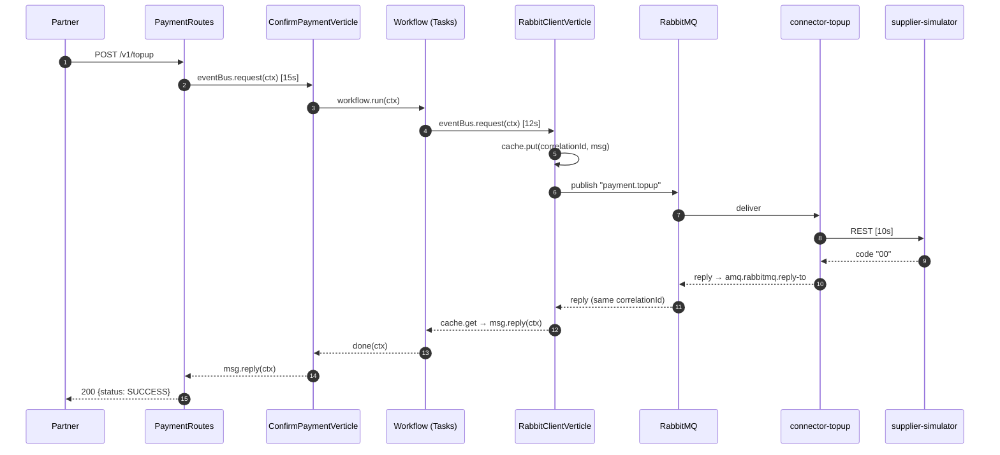
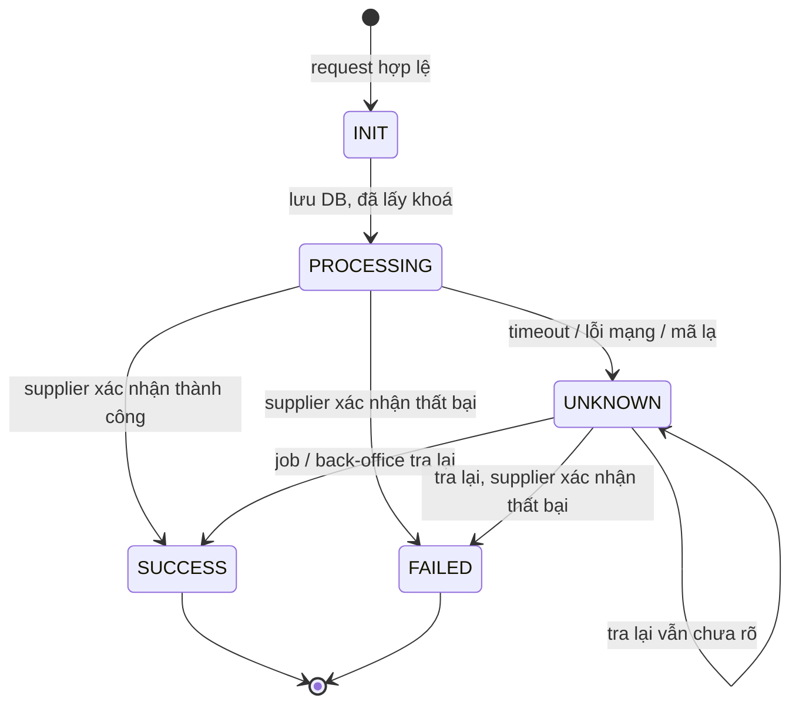
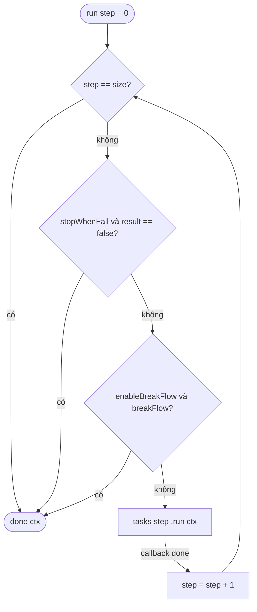

# Bài 00 — Tóm tắt kiến trúc

Đọc trước Task 0 để chắc hai bên hiểu giống nhau. Chi tiết đầy đủ: `.claude/specs/2026-11-21-payment-hub-design.md`.

## Thuật ngữ

- **partner**: bên gọi vào Hub (REST, ký HMAC).
- **connector**: service của mình, Hub gọi qua RabbitMQ; connector gọi tiếp supplier.
- **supplier**: nhà cung cấp bên ngoài. Ở đây là `supplier-simulator` (giả lập, giống dự án thật).
- **back-office**: công cụ nội bộ gọi Hub qua gRPC.

## Kiến trúc trong 10 dòng

1. **Partner** gọi Hub bằng REST (ký HMAC); **back-office** gọi bằng gRPC.
2. Trong Hub, **Route** chỉ đọc/kiểm tra input → gói thành `PaymentContext` → gửi qua **EventBus**. Route không chứa nghiệp vụ.
3. **WorkflowVerticle** nhận context, chạy một **Workflow** = chuỗi **Task** tuần tự kiểu callback.
4. Task lỗi → `result=false` + gọi `done` (không throw). Workflow dừng khi `result=false` hoặc `breakFlow=true`.
5. Task cần gọi supplier → gửi qua EventBus tới **RabbitClientVerticle**.
6. RabbitClientVerticle publish vào queue `payment.<service>` (`payment.topup` / `payment.billing`), kèm `correlationId`, `replyTo=amq.rabbitmq.reply-to`, header `x-request-id`, `x-partner-code`.
7. Message đang chờ được giữ trong cache Caffeine theo `correlationId`, tự hết hạn → không rò bộ nhớ.
8. **connector-topup / connector-billing** nhận message → gọi REST tới **supplier-simulator** → đổi mã supplier thành SUCCESS / FAILED / UNKNOWN → reply theo `replyTo`.
9. Hub tìm `correlationId` trong cache → trả ngược Task → Workflow → Route → partner. Timeout xếp tầng **10s** (connector chờ supplier) < **12s** (Task chờ connector) < **15s** (Route chờ Workflow).
10. Tiền: chỉ **FAILED** khi supplier xác nhận thất bại. Timeout / mã lạ → **UNKNOWN**, có job tra lại.

## Luồng một request topup

Xem bằng VS Code + extension "Markdown Preview Mermaid Support" (`Ctrl+Shift+V`) hoặc https://mermaid.live.

## Trạng thái giao dịch

## Activity: Workflow chạy chuỗi Task

