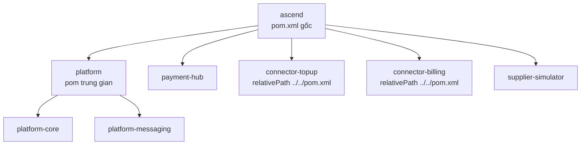
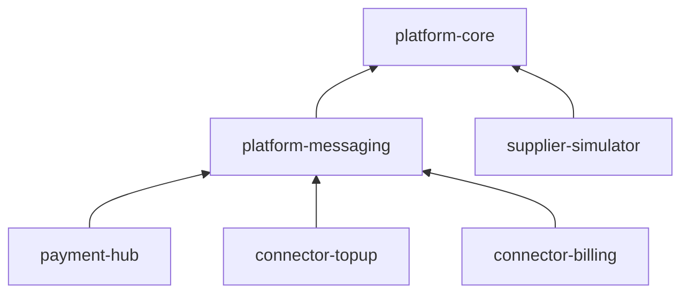
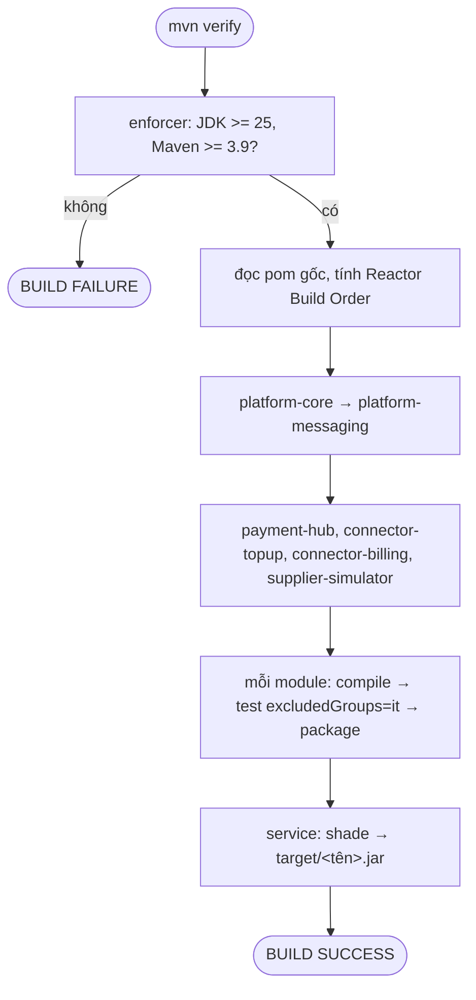
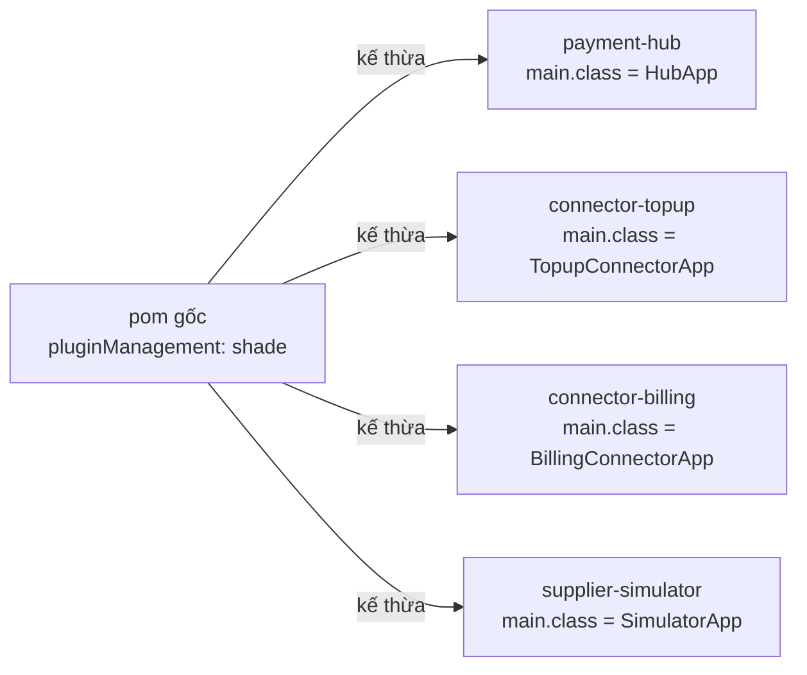

# Bài 01 — Task 0: Maven multi-module, Java 25, docker-compose

Plan: `.claude/plans/2026-11-21-payment-hub.md` → Task 0. Xong thì báo **"xong task 0"** (hoặc dán log lỗi).

## (a) Vì sao cần bước này

Monorepo chỉ chạy gọn khi **Maven biết hết các module và cấu hình chung nằm ở một chỗ** (pom gốc). Phiên bản
thư viện khai một lần trong `dependencyManagement`; module Vert.x lấy version từ BOM `vertx-stack-depchain` nên
`vertx-core` và `vertx-web` không bao giờ lệch nhau. Maven không tự tải JDK như Gradle, nên dùng `.sdkmanrc`
chọn JDK 25 và `enforcer` chặn nếu lỡ chạy bằng JDK 21. Docker Compose dựng sẵn Postgres, RabbitMQ, Redis cho
các task sau.

## (b) Sơ đồ

Quan hệ **parent** giữa các pom (con kế thừa cấu hình của cha):



Module nào **dùng** module nào (dependency) — mũi tên chỉ về `platform`, `payment-hub` và `connector-*` không nối nhau:



Activity: Maven chạy `mvn verify` qua các module:



## (c) Code

Phiên bản đã tra trên Maven Central (2026-11-21): Vert.x 5.2.3, Guice 7.0.0, Lombok 1.18.48, Caffeine 3.3.1,
JUnit 5.14.4; plugin compiler 3.16.0, surefire 3.6.1, shade 3.6.2, enforcer 3.7.0.

### Bước 1: chọn JDK 25

`.sdkmanrc` ở gốc repo:

```
java=25.0.2-tem
```

```bash
sdk env          # đổi JDK cho phiên terminal này
mvn -v           # phải thấy "Java version: 25.0.2"
```

Muốn tự đổi mỗi lần `cd` vào repo: đặt `sdkman_auto_env=true` trong `~/.sdkman/etc/config`.

### Bước 2: `pom.xml` gốc (phần cốt lõi, đưa đầy đủ)

```xml
<?xml version="1.0" encoding="UTF-8"?>
<project xmlns="http://maven.apache.org/POM/4.0.0"
         xmlns:xsi="http://www.w3.org/2001/XMLSchema-instance"
         xsi:schemaLocation="http://maven.apache.org/POM/4.0.0 https://maven.apache.org/xsd/maven-4.0.0.xsd">
  <modelVersion>4.0.0</modelVersion>

  <groupId>dev.gawio</groupId>
  <artifactId>ascend</artifactId>
  <version>0.1.0-SNAPSHOT</version>
  <packaging>pom</packaging>

  <modules>
    <module>platform</module>
    <module>payment-hub</module>
    <module>connector/connector-topup</module>
    <module>connector/connector-billing</module>
    <module>supplier-simulator</module>
  </modules>

  <properties>
    <maven.compiler.release>25</maven.compiler.release>
    <project.build.sourceEncoding>UTF-8</project.build.sourceEncoding>
    <vertx.version>5.2.3</vertx.version>
    <guice.version>7.0.0</guice.version>
    <lombok.version>1.18.48</lombok.version>
    <caffeine.version>3.3.1</caffeine.version>
    <junit.version>5.14.4</junit.version>
    <!-- mặc định bỏ test tích hợp; profile "it" đảo lại -->
    <excludedGroups>it</excludedGroups>
  </properties>

  <dependencyManagement>
    <dependencies>
      <dependency>
        <groupId>io.vertx</groupId>
        <artifactId>vertx-stack-depchain</artifactId>
        <version>${vertx.version}</version>
        <type>pom</type>
        <scope>import</scope>
      </dependency>
      <dependency>
        <groupId>org.junit</groupId>
        <artifactId>junit-bom</artifactId>
        <version>${junit.version}</version>
        <type>pom</type>
        <scope>import</scope>
      </dependency>
      <dependency>
        <groupId>com.google.inject</groupId>
        <artifactId>guice</artifactId>
        <version>${guice.version}</version>
      </dependency>
      <!-- TODO(bạn gõ): caffeine (${caffeine.version}), lombok (${lombok.version}),
           dev.gawio:platform-core và dev.gawio:platform-messaging (${project.version}) -->
    </dependencies>
  </dependencyManagement>

  <!-- mọi module đều có -->
  <dependencies>
    <dependency>
      <groupId>org.projectlombok</groupId>
      <artifactId>lombok</artifactId>
      <scope>provided</scope>
    </dependency>
    <dependency>
      <groupId>org.junit.jupiter</groupId>
      <artifactId>junit-jupiter</artifactId>
      <scope>test</scope>
    </dependency>
    <dependency>
      <groupId>io.vertx</groupId>
      <artifactId>vertx-junit5</artifactId>
      <scope>test</scope>
    </dependency>
  </dependencies>

  <build>
    <pluginManagement>
      <plugins>
        <plugin>
          <groupId>org.apache.maven.plugins</groupId>
          <artifactId>maven-compiler-plugin</artifactId>
          <version>3.16.0</version>
          <configuration>
            <!-- JDK 23+ không tự dò annotation processor → phải khai báo -->
            <annotationProcessorPaths>
              <path>
                <groupId>org.projectlombok</groupId>
                <artifactId>lombok</artifactId>
                <version>${lombok.version}</version>
              </path>
            </annotationProcessorPaths>
          </configuration>
        </plugin>
        <!-- TODO(bạn gõ): maven-surefire-plugin 3.6.1, maven-shade-plugin 3.6.2 (chỉ khai version) -->
      </plugins>
    </pluginManagement>

    <plugins>
      <plugin>
        <groupId>org.apache.maven.plugins</groupId>
        <artifactId>maven-enforcer-plugin</artifactId>
        <version>3.7.0</version>
        <executions>
          <execution>
            <id>enforce</id>
            <goals><goal>enforce</goal></goals>
            <configuration>
              <rules>
                <requireJavaVersion><version>[25,)</version></requireJavaVersion>
                <!-- TODO(bạn gõ): requireMavenVersion [3.9,) -->
              </rules>
            </configuration>
          </execution>
        </executions>
      </plugin>
    </plugins>
  </build>

  <profiles>
    <profile>
      <id>it</id>
      <properties>
        <groups>it</groups>
        <excludedGroups>none</excludedGroups>
      </properties>
    </profile>
  </profiles>
</project>
```

Mẹo: surefire đọc property `groups` / `excludedGroups`. Khai trong `<properties>` (không khai trong cấu hình
plugin) thì profile `it` mới ghi đè được.

### Bước 3: `platform/pom.xml` (pom trung gian duy nhất)

```xml
<project ...>
  <modelVersion>4.0.0</modelVersion>
  <parent>
    <groupId>dev.gawio</groupId>
    <artifactId>ascend</artifactId>
    <version>0.1.0-SNAPSHOT</version>
  </parent>
  <artifactId>platform</artifactId>
  <packaging>pom</packaging>
  <modules>
    <module>platform-core</module>
    <module>platform-messaging</module>
  </modules>
</project>
```

### Bước 4: pom lá

`platform/platform-core/pom.xml` (mẫu cho thư viện):

```xml
<project ...>
  <modelVersion>4.0.0</modelVersion>
  <parent>
    <groupId>dev.gawio</groupId>
    <artifactId>platform</artifactId>
    <version>0.1.0-SNAPSHOT</version>
  </parent>
  <artifactId>platform-core</artifactId>

  <dependencies>
    <dependency><groupId>io.vertx</groupId><artifactId>vertx-core</artifactId></dependency>
    <dependency><groupId>com.google.inject</groupId><artifactId>guice</artifactId></dependency>
    <dependency><groupId>com.fasterxml.jackson.core</groupId><artifactId>jackson-databind</artifactId></dependency>
  </dependencies>
</project>
```

Không dòng nào ghi version: đã quản lý ở pom gốc và BOM Vert.x.

`payment-hub/pom.xml` (mẫu cho service có fat jar):

```xml
<project ...>
  <modelVersion>4.0.0</modelVersion>
  <parent>
    <groupId>dev.gawio</groupId>
    <artifactId>ascend</artifactId>
    <version>0.1.0-SNAPSHOT</version>
  </parent>
  <artifactId>payment-hub</artifactId>

  <dependencies>
    <dependency><groupId>dev.gawio</groupId><artifactId>platform-messaging</artifactId></dependency>
    <dependency><groupId>io.vertx</groupId><artifactId>vertx-web</artifactId></dependency>
    <dependency><groupId>io.vertx</groupId><artifactId>vertx-pg-client</artifactId></dependency>
    <dependency><groupId>io.vertx</groupId><artifactId>vertx-redis-client</artifactId></dependency>
  </dependencies>

  <build>
    <finalName>payment-hub</finalName>
    <plugins>
      <plugin>
        <groupId>org.apache.maven.plugins</groupId>
        <artifactId>maven-shade-plugin</artifactId>
        <executions>
          <execution>
            <phase>package</phase>
            <goals><goal>shade</goal></goals>
            <configuration>
              <createDependencyReducedPom>false</createDependencyReducedPom>
              <transformers>
                <transformer implementation="org.apache.maven.plugins.shade.resource.ManifestResourceTransformer">
                  <mainClass>dev.gawio.payhub.hub.HubApp</mainClass>
                </transformer>
                <!-- Vert.x tìm codec/transport qua ServiceLoader → phải gộp META-INF/services -->
                <transformer implementation="org.apache.maven.plugins.shade.resource.ServicesResourceTransformer"/>
              </transformers>
              <filters>
                <filter>
                  <artifact>*:*</artifact>
                  <excludes>
                    <exclude>META-INF/*.SF</exclude>
                    <exclude>META-INF/*.DSA</exclude>
                    <exclude>META-INF/*.RSA</exclude>
                  </excludes>
                </filter>
              </filters>
            </configuration>
          </execution>
        </executions>
      </plugin>
    </plugins>
  </build>
</project>
```

```
<!-- TODO(bạn gõ):
 - platform/platform-messaging/pom.xml: parent platform; deps platform-core, vertx-rabbitmq-client, caffeine
 - connector/connector-topup/pom.xml: parent ascend + <relativePath>../../pom.xml</relativePath>;
     deps platform-messaging, vertx-web-client; shade như payment-hub,
     finalName connector-topup, mainClass dev.gawio.connector.topup.TopupConnectorApp
 - connector/connector-billing/pom.xml: tương tự, BillingConnectorApp
 - supplier-simulator/pom.xml: parent ascend; deps platform-core, vertx-web; shade,
     mainClass dev.gawio.simulator.SimulatorApp -->
```

### Bước 5: `docker-compose.yml`

```yaml
services:
  postgres:
    image: postgres:17
    command: postgres -c wal_level=logical      # để sẵn cho EMS (CDC) sau này
    environment:
      POSTGRES_DB: payhub
      POSTGRES_USER: payhub
      POSTGRES_PASSWORD: ${DB_PASSWORD}
    ports: ["5432:5432"]
    volumes:
      - ./payment-hub/src/main/resources/db:/docker-entrypoint-initdb.d:ro
    healthcheck:
      test: ["CMD-SHELL", "pg_isready -U payhub -d payhub"]
      interval: 5s
      retries: 10

  # TODO(bạn gõ): rabbitmq (image rabbitmq:4-management, port 5672 + 15672,
  #   healthcheck: rabbitmq-diagnostics -q ping)
  # TODO(bạn gõ): redis (image redis:7, port 6379, healthcheck: redis-cli ping)
```

Tạo sẵn thư mục `db` trước khi chạy compose (nếu không, Docker tự tạo với quyền root):

```bash
mkdir -p payment-hub/src/main/resources/db
```

### Bước 6: `.env.example`, `.env`, `.gitignore`, `.gitattributes`

- `.env.example` (commit file này): `DB_PASSWORD=`, `PARTNER_SECRET_PARTNER_X=`, `BACKOFFICE_TOKEN=`. Chép thành `.env` rồi điền `DB_PASSWORD`.
- `.gitignore`: thay nội dung Gradle bằng `target/`, `.idea/`, `*.iml`, `.env`, `.claude/settings.local.json`.
- `.gitattributes`: xoá dòng `/gradlew`, giữ `*.jar binary`.

### Bước 7: một file để `platform-core` có thứ biên dịch

```bash
mkdir -p platform/platform-core/src/main/java/dev/gawio/platform/core
echo 'package dev.gawio.platform.core;' > platform/platform-core/src/main/java/dev/gawio/platform/core/package-info.java
```

## (d) Điểm kiểm tra

```bash
mvn validate
#  → "Reactor Build Order" liệt kê đủ 8 pom: ascend, platform, platform-core,
#    platform-messaging, payment-hub, connector-topup, connector-billing, supplier-simulator

mvn verify                                  # BUILD SUCCESS
ls payment-hub/target/payment-hub.jar       # có file

mvn -q -pl payment-hub -am dependency:tree | grep vertx-core
#  → io.vertx:vertx-core:jar:5.2.3

sdk use java 21.0.3-tem && mvn validate     # phải FAIL: enforcer báo JDK không nằm trong [25,)
sdk env                                     # quay lại JDK 25

docker compose up -d && docker compose ps   # 3 container đều "healthy"
```

Mở http://localhost:15672 (`guest` / `guest`) → thấy giao diện RabbitMQ.

Commit: `git add -A && git commit -m "build: maven multi-module, java 25, docker-compose"`

## (e) Câu hỏi tự kiểm tra

1. Pom của `connector-topup` thiếu `<relativePath>../../pom.xml</relativePath>` thì chuyện gì xảy ra?
   <details><summary>Đáp án</summary>Maven mặc định tìm parent ở <code>../pom.xml</code>, tức <code>connector/pom.xml</code>. File này không có, nên Maven đi tìm <code>ascend</code> trong local repo / Maven Central. Không thấy → lỗi "Non-resolvable parent POM". Thấy một bản cũ đã install từ trước thì tệ hơn: build dùng cấu hình cũ mà không báo gì.</details>

2. Pom của `platform-core` không ghi version cho `jackson-databind`. Version lấy từ đâu?
   <details><summary>Đáp án</summary>BOM <code>vertx-stack-depchain</code> được import trong <code>dependencyManagement</code> của pom gốc; BOM này import tiếp <code>jackson-bom</code>, nên Jackson luôn khớp bản Vert.x 5.2.3 đã kiểm thử cùng.</details>

3. Vì sao `mvn test` không chạy test `@Tag("it")`, còn `mvn -Pit test` chỉ chạy những test đó?
   <details><summary>Đáp án</summary>Surefire đọc property <code>excludedGroups</code> và <code>groups</code>. Mặc định <code>excludedGroups=it</code> nên test tích hợp bị bỏ. Profile <code>it</code> đặt <code>groups=it</code> (chỉ chạy tag này) và đổi <code>excludedGroups</code> thành tag không tồn tại.</details>

---

## Đã setup (2026-11-21, AI làm theo yêu cầu của người dùng)

Người dùng nhờ AI xoá phần cũ và setup luôn Task 0. Phần cũ bị xoá: project sinh từ Maven archetype
(`payment-hub/` và `connector/` có `App.java` Hello World + test JUnit 3) và `platform/core`, `platform/messaging`
(pom của `messaging` bị trùng artifactId `platform-core`).

Khác so với bài ở trên (để gọn hơn):

- **Shade khai một lần ở `pluginManagement` của pom gốc.** Service chỉ cần khai plugin (không cấu hình) và đặt
  property `main.class`. `finalName = ${project.artifactId}` cũng đặt ở gốc.
- Shade bỏ thêm `module-info.class` (fat jar không phải JPMS module) để hết cảnh báo.
- `docker-compose.yml` dùng `${DB_PASSWORD:?...}`: thiếu `.env` thì compose báo lỗi rõ ràng thay vì chạy với mật khẩu rỗng. Thêm volume `pgdata`.
- `payment-hub/src/main/resources/db/.gitkeep` để git giữ thư mục rỗng.
- `.gitignore` / `.gitattributes` viết lại cho Maven.



Kết quả kiểm tra đã chạy:

| Kiểm tra | Kết quả |
|---|---|
| `mvn clean verify` (JDK 25) | BUILD SUCCESS, Reactor đủ 8 pom |
| `payment-hub/target/payment-hub.jar` | ~19 MB, `Main-Class: dev.gawio.payhub.hub.HubApp` |
| `vertx-core` | 5.2.3 |
| `mvn validate` bằng JDK 21 | BUILD FAILURE (enforcer `RequireJavaVersion`) — đúng mong đợi |
| `docker compose config` | hợp lệ |

Việc người dùng còn làm:

```bash
sdk env                                  # JDK 25
cp .env.example .env                     # điền DB_PASSWORD
docker compose up -d && docker compose ps   # 3 container healthy; UI http://localhost:15672 (guest/guest)
git add -A && git commit -m "build: maven multi-module, java 25, docker-compose"
```

Sau đó đọc phần (e) câu hỏi tự kiểm ở trên rồi chuyển sang Task 1.
