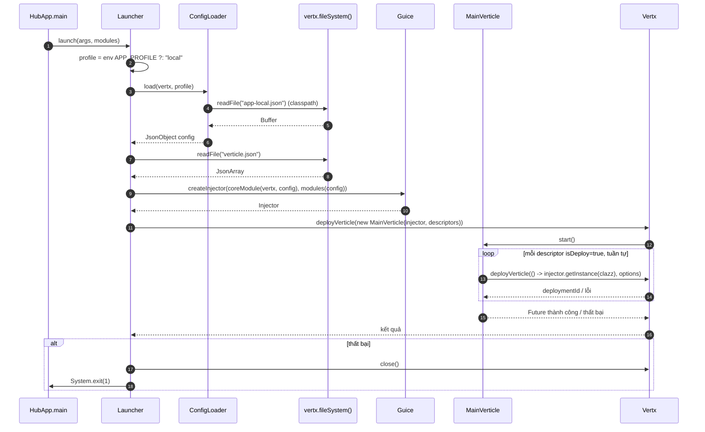
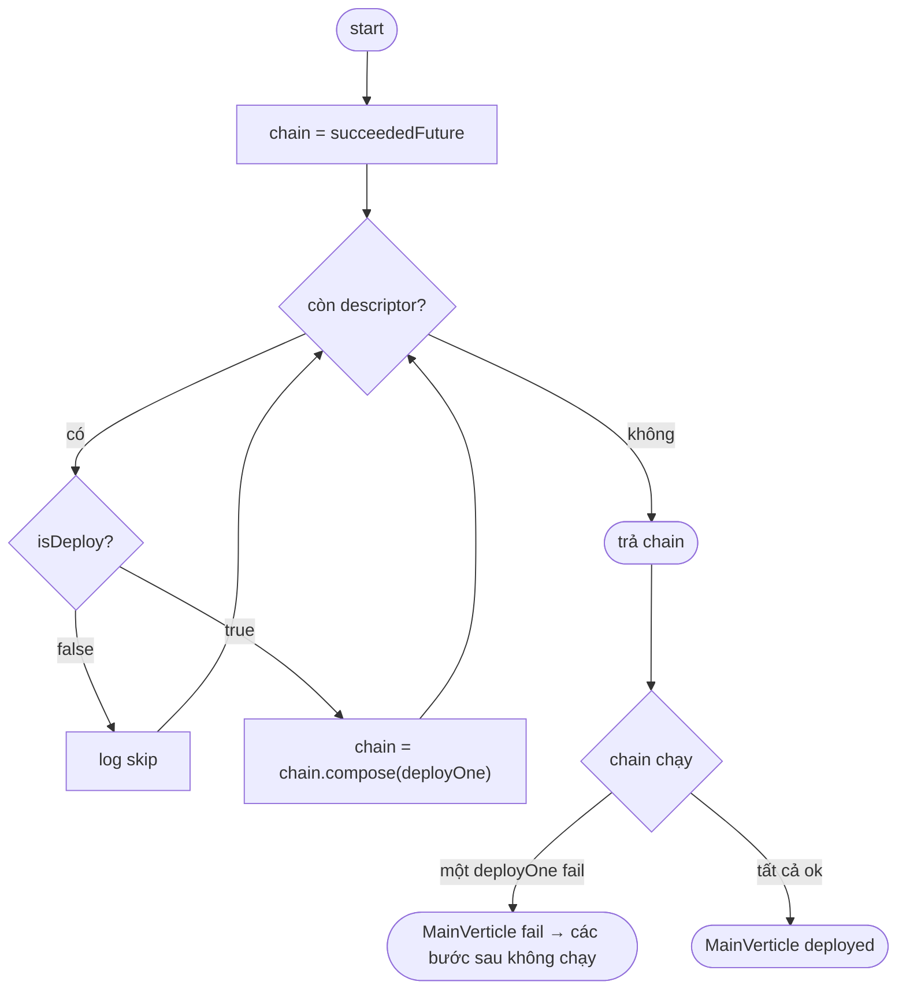
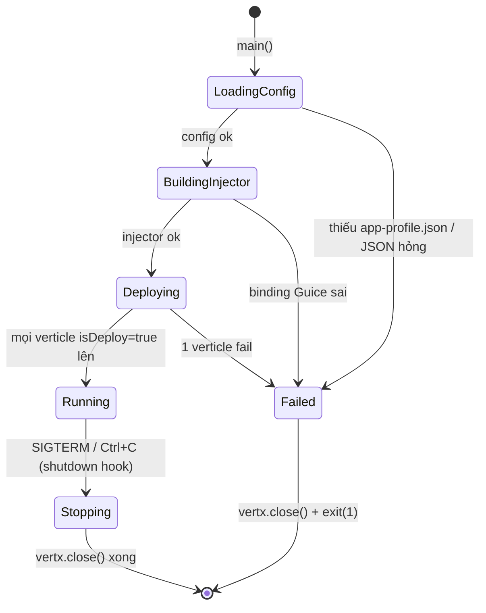

# Bài 02 — Task 1: Launcher + MainVerticle + verticle.json + config profile + Guice

Plan: `.claude/plans/2026-11-21-payment-hub.md` → Task 1. Code trong bài đã được AI chạy thử (điền các TODO) trên JDK 25: 5/5 test PASS. Toàn bộ code nằm trong `platform/platform-core`
(package `dev.gawio.platform.core`). Xong thì báo **"xong task 1"** (hoặc dán log lỗi).

## (a) Vì sao cần bước này

Mọi service (hub, 2 connector, simulator) đều khởi động giống nhau: đọc config theo môi trường, dựng Guice,
rồi deploy một danh sách verticle. Viết phần đó **một lần** trong `platform-core` thì mỗi service chỉ còn một
hàm `main` 3 dòng. Danh sách verticle nằm trong `verticle.json` chứ không nằm trong code, nên bật/tắt một
verticle (`isDeploy`) hay đổi số instance không cần biên dịch lại. Deploy **tuần tự** và **dừng ngay khi một cái
hỏng** (fail fast): service chạy thiếu một mảnh nguy hiểm hơn service không chạy, vì nó nhận request rồi treo.
Guice tạo verticle để verticle nhận phụ thuộc (repository, client…) qua constructor thay vì tự `new`.

## (b) Sơ đồ

**Sequence: một service khởi động**



**Activity: `MainVerticle.start()` deploy tuần tự, fail fast**



**State machine: vòng đời của service**



## (c) Code

File cần tạo:

```
platform/platform-core/src/main/java/dev/gawio/platform/core/
  VerticleDescriptor.java   ConfigLoader.java   MainVerticle.java   Launcher.java
platform/platform-core/src/test/java/dev/gawio/platform/core/
  MainVerticleTest.java   ConfigLoaderTest.java   HelloVerticle.java   BrokenVerticle.java
platform/platform-core/src/test/resources/
  app-test.json
```

Log: dùng `System.Logger` có sẵn trong JDK (không thêm thư viện; Task 8 sẽ format thành JSON).

### Bước 1 — Viết test trước (để thấy nó FAIL)

`src/test/java/.../HelloVerticle.java` và `BrokenVerticle.java` (fixture):

```java
package dev.gawio.platform.core;

import io.vertx.core.Future;
import io.vertx.core.VerticleBase;
import java.util.concurrent.atomic.AtomicInteger;

public class HelloVerticle extends VerticleBase {
  static final AtomicInteger STARTED = new AtomicInteger();

  @Override
  public Future<?> start() {
    STARTED.incrementAndGet();
    return Future.succeededFuture();
  }
}
```

```java
// TODO(bạn gõ): BrokenVerticle extends VerticleBase, start() trả Future.failedFuture("boom")
```

`src/test/resources/app-test.json`:

```json
{ "name": "payhub-test" }
```

`src/test/java/.../MainVerticleTest.java`:

```java
package dev.gawio.platform.core;

import static org.junit.jupiter.api.Assertions.*;

import com.google.inject.Guice;
import io.vertx.core.Vertx;
import io.vertx.junit5.VertxExtension;
import io.vertx.junit5.VertxTestContext;
import java.util.List;
import org.junit.jupiter.api.BeforeEach;
import org.junit.jupiter.api.Test;
import org.junit.jupiter.api.extension.ExtendWith;

@ExtendWith(VertxExtension.class)
class MainVerticleTest {

  @BeforeEach
  void reset() { HelloVerticle.STARTED.set(0); }

  @Test
  void deploysOnlyEnabledVerticles(Vertx vertx, VertxTestContext ctx) {
    var list = List.of(
        new VerticleDescriptor("hello", HelloVerticle.class.getName(), 1, true),
        new VerticleDescriptor("skip", BrokenVerticle.class.getName(), 1, false));

    vertx.deployVerticle(new MainVerticle(Guice.createInjector(), list))
        .onComplete(ctx.succeeding(id -> ctx.verify(() -> {
          assertEquals(1, HelloVerticle.STARTED.get());
          ctx.completeNow();
        })));
  }

  @Test
  void failsFastWhenAVerticleFails(Vertx vertx, VertxTestContext ctx) {
    // TODO(bạn gõ): list = [Broken (isDeploy=true), Hello (isDeploy=true)]
    //   deploy MainVerticle → ctx.failing(err -> ...): assertEquals(0, HelloVerticle.STARTED.get())
  }

  @Test
  void runsOneObjectPerInstance(Vertx vertx, VertxTestContext ctx) {
    // TODO(bạn gõ): Hello với instances = 3 → STARTED == 3
  }
}
```

`src/test/java/.../ConfigLoaderTest.java`:

```java
@ExtendWith(VertxExtension.class)
class ConfigLoaderTest {

  @Test
  void loadsProfileConfig(Vertx vertx, VertxTestContext ctx) {
    ConfigLoader.load(vertx, "test")
        .onComplete(ctx.succeeding(json -> ctx.verify(() -> {
          assertEquals("payhub-test", json.getString("name"));
          ctx.completeNow();
        })));
  }

  @Test
  void missingProfileFails(Vertx vertx, VertxTestContext ctx) {
    // TODO(bạn gõ): load(vertx, "nope") → ctx.failing(err -> message chứa "app-nope.json")
  }
}
```

Chạy: `mvn -pl platform/platform-core test` → **FAIL biên dịch** (chưa có class). Đúng mong đợi.

### Bước 2 — `VerticleDescriptor`

Một dòng trong `verticle.json`:

```json
[
  { "name": "http",    "address": "dev.gawio.payhub.hub.api.HttpServerVerticle", "instances": 2, "isDeploy": true },
  { "name": "confirm", "address": "dev.gawio.payhub.hub.flow.ConfirmPaymentVerticle", "instances": 1, "isDeploy": true }
]
```

```java
package dev.gawio.platform.core;

import io.vertx.core.json.JsonArray;
import io.vertx.core.json.JsonObject;
import java.util.List;

/** One entry of verticle.json. address = fully qualified class name. */
public record VerticleDescriptor(String name, String address, int instances, boolean isDeploy) {

  public static List<VerticleDescriptor> parse(JsonArray array) {
    // TODO(bạn gõ): duyệt array (mỗi phần tử là JsonObject) → new VerticleDescriptor(...)
    //   instances mặc định 1, isDeploy mặc định true (gợi ý: getInteger(key, def), getBoolean(key, def))
    //   name hoặc address thiếu → throw IllegalArgumentException("verticle.json: missing name/address at index " + i)
    throw new UnsupportedOperationException("TODO");
  }
}
```

### Bước 3 — `ConfigLoader`

```java
package dev.gawio.platform.core;

import io.vertx.core.Future;
import io.vertx.core.Vertx;
import io.vertx.core.buffer.Buffer;
import io.vertx.core.json.JsonObject;

public final class ConfigLoader {
  private ConfigLoader() {}

  /** Reads app-<profile>.json from the classpath without blocking the event loop. */
  public static Future<JsonObject> load(Vertx vertx, String profile) {
    String file = "app-" + profile + ".json";
    return vertx.fileSystem().readFile(file)          // Vert.x tìm trên đĩa, không thấy thì tìm trong classpath
        .recover(err -> Future.failedFuture("Config not found: " + file))
        .map(Buffer::toJsonObject);                   // JSON hỏng → DecodeException đi tiếp, không bị đổi tên
  }
}
```

Để ý thứ tự: `recover` đứng **trước** `map`. Nếu đặt sau, lỗi "JSON hỏng" cũng bị báo thành "Config not found",
và bạn sẽ mất thời gian đi tìm một file đang nằm ngay đó.

### Bước 4 — `MainVerticle` (lõi của bài, đưa đầy đủ)

```java
package dev.gawio.platform.core;

import static java.lang.System.Logger.Level.ERROR;
import static java.lang.System.Logger.Level.INFO;

import com.google.inject.Injector;
import io.vertx.core.Deployable;
import io.vertx.core.DeploymentOptions;
import io.vertx.core.Future;
import io.vertx.core.VerticleBase;
import java.util.List;

/** Deploys verticle.json entries one by one; the first failure stops everything. */
public class MainVerticle extends VerticleBase {
  private static final System.Logger LOG = System.getLogger(MainVerticle.class.getName());

  private final Injector injector;
  private final List<VerticleDescriptor> verticles;

  public MainVerticle(Injector injector, List<VerticleDescriptor> verticles) {
    this.injector = injector;
    this.verticles = verticles;
  }

  @Override
  public Future<?> start() {
    Future<Void> chain = Future.succeededFuture();
    for (VerticleDescriptor d : verticles) {
      if (!d.isDeploy()) {
        LOG.log(INFO, "skip {0} (isDeploy=false)", d.name());
        continue;
      }
      chain = chain.compose(v -> deployOne(d));   // chạy sau khi bước trước XONG và THÀNH CÔNG
    }
    return chain;
  }

  private Future<Void> deployOne(VerticleDescriptor d) {
    Class<? extends Deployable> clazz;
    try {
      clazz = Class.forName(d.address()).asSubclass(Deployable.class);
    } catch (ClassNotFoundException | ClassCastException e) {
      return Future.failedFuture(new IllegalArgumentException("Bad verticle address: " + d.address(), e));
    }
    var options = new DeploymentOptions().setInstances(d.instances()).setConfig(config());
    return vertx.deployVerticle(() -> injector.getInstance(clazz), options)  // Supplier: mỗi instance 1 object mới
        .onSuccess(id -> LOG.log(INFO, "deploy {0} success x{1}", d.name(), d.instances()))
        .onFailure(e -> LOG.log(ERROR, "deploy {0} failed: {1}", d.name(), e.getMessage()))
        .mapEmpty();
  }
}
```

### Bước 5 — `Launcher`

```java
package dev.gawio.platform.core;

import static java.lang.System.Logger.Level.ERROR;
import static java.lang.System.Logger.Level.INFO;

import com.google.inject.AbstractModule;
import com.google.inject.Guice;
import com.google.inject.Module;
import com.google.inject.name.Names;
import io.vertx.core.DeploymentOptions;
import io.vertx.core.Future;
import io.vertx.core.Vertx;
import io.vertx.core.json.JsonObject;
import java.util.ArrayList;
import java.util.List;
import java.util.function.Function;

public final class Launcher {
  private static final System.Logger LOG = System.getLogger(Launcher.class.getName());
  private Launcher() {}

  /** For main(): start, and exit(1) if anything fails. */
  public static void launch(String[] args, Function<JsonObject, List<Module>> modules) {
    run(args, modules)
        .onSuccess(vertx -> {
          Runtime.getRuntime().addShutdownHook(new Thread(() -> vertx.close().await()));
          LOG.log(INFO, "started");
        })
        .onFailure(err -> {
          LOG.log(ERROR, "startup failed: " + err.getMessage(), err);
          System.exit(1);
        });
  }

  /** Testable: no System.exit here. Closes Vert.x itself when startup fails. */
  public static Future<Vertx> run(String[] args, Function<JsonObject, List<Module>> modules) {
    String profile = System.getenv().getOrDefault("APP_PROFILE", "local");
    Vertx vertx = Vertx.vertx();
    // Task 2: vertx.eventBus().registerCodec(new AppDataCodec());

    return ConfigLoader.load(vertx, profile)
        .compose(config -> vertx.fileSystem().readFile("verticle.json")
            .map(buf -> {
              List<Module> all = new ArrayList<>();
              all.add(coreModule(vertx, config));
              all.addAll(modules.apply(config));
              return new MainVerticle(Guice.createInjector(all), VerticleDescriptor.parse(buf.toJsonArray()));
            })
            .compose(main -> vertx.deployVerticle(main, new DeploymentOptions().setConfig(config))))
        .map(id -> vertx)
        .recover(err -> vertx.close().transform(ignored -> Future.failedFuture(err)));
  }

  private static Module coreModule(Vertx vertx, JsonObject config) {
    // TODO(bạn gõ): AbstractModule có configure():
    //   bind(Vertx.class).toInstance(vertx);
    //   bind(JsonObject.class).annotatedWith(Names.named("config")).toInstance(config);
    throw new UnsupportedOperationException("TODO");
  }
}
```

Shutdown hook dùng `.await()`: hợp lệ vì hook chạy trên thread riêng của JVM, **không phải event loop**.
Gọi `.await()` trên event loop là chặn event loop — luật số 1 của dự án.

Service dùng như sau (Task 3 mới tạo `HubApp`, ở đây chỉ để thấy hình dạng):

```java
public class HubApp {
  public static void main(String[] args) {
    Launcher.launch(args, config -> List.of(new HubModule(config)));
  }
}
```

### Bước 6 — Chạy test

```bash
mvn -pl platform/platform-core test
```

## (d) Điểm kiểm tra

| Lệnh / tình huống | Mong đợi |
|---|---|
| `mvn -pl platform/platform-core test` | `Tests run: 5, Failures: 0, Errors: 0` |
| Log khi chạy `deploysOnlyEnabledVerticles` | có `skip skip (isDeploy=false)` và `deploy hello success x1` |
| Log khi chạy `failsFastWhenAVerticleFails` | có `deploy broken failed: boom`, **không** có `deploy hello success` |
| Thử đổi `recover` xuống sau `map` trong `ConfigLoader`, tạo `app-bad.json` nội dung `{oops` | lỗi báo "Config not found" dù file có thật → đổi lại như cũ |

Lỗi `Could not transfer artifact ... (absent)` / `Temporary failure in name resolution`: Maven đã ghi nhớ lần tải hỏng vì mạng chập chờn. Kiểm tra mạng rồi chạy lại kèm `-U`: `mvn -U -pl platform/platform-core test`.

`Launcher.run` chưa có test riêng ở task này; nó được chạy thật ở Task 3 khi `HubApp` khởi động.

Commit: `git add -A && git commit -m "feat(core): launcher, MainVerticle, verticle.json, profile config"`

## (e) Câu hỏi tự kiểm tra

1. Nếu thay vòng `compose` bằng việc gọi `deployVerticle` cho tất cả cùng lúc rồi `Future.all(...)`, test
   `failsFastWhenAVerticleFails` còn qua không?
   <details><summary>Đáp án</summary>Không. Deploy song song thì <code>HelloVerticle</code> vẫn được start dù <code>BrokenVerticle</code> fail, nên <code>STARTED == 1</code>. Còn tệ hơn: app đã thất bại nhưng Hello vẫn đang chạy cho tới khi <code>vertx.close()</code>. <code>compose</code> chỉ chạy bước sau khi bước trước thành công — đó là "fail fast".</details>

2. Vì sao truyền `() -> injector.getInstance(clazz)` (Supplier) thay vì `injector.getInstance(clazz)` (một object)?
   <details><summary>Đáp án</summary>Với <code>instances = 3</code>, Vert.x cần 3 object riêng, mỗi cái gắn với một event loop. Supplier được gọi 3 lần → 3 object. Truyền sẵn 1 object mà <code>instances &gt; 1</code> thì Vert.x từ chối deploy. Hệ quả: <b>đừng</b> bind verticle là singleton trong Guice.</details>

3. `ConfigLoader` dùng `vertx.fileSystem().readFile` thay cho `Files.readString`. Ở chỗ này khác nhau ra sao, và
   tại sao vẫn đọc được file nằm trong jar?
   <details><summary>Đáp án</summary><code>Files.readString</code> là I/O chặn; gọi trong callback trên event loop sẽ chặn loop. <code>vertx.fileSystem()</code> chạy I/O trên worker pool và trả <code>Future</code>. File resolver của Vert.x không thấy file trên đĩa thì tìm trong classpath (kể cả trong fat jar), nên <code>app-local.json</code> trong <code>src/main/resources</code> vẫn đọc được.</details>
