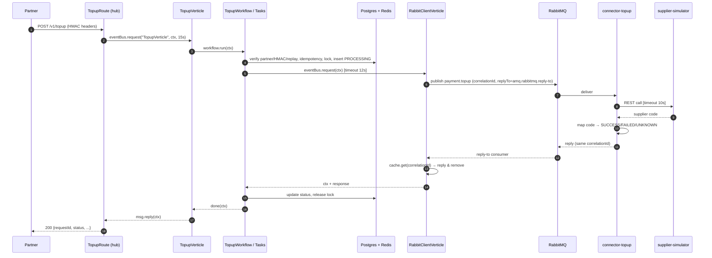
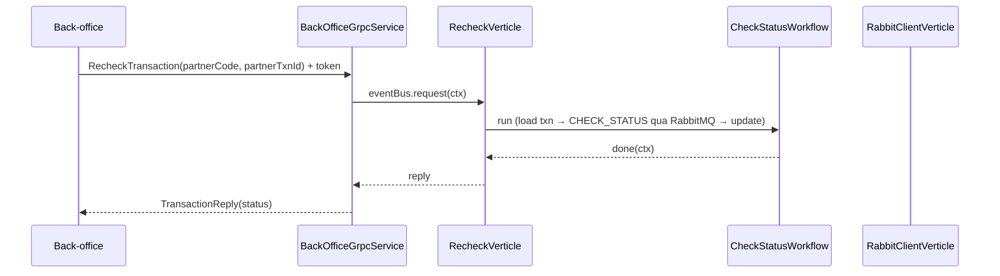
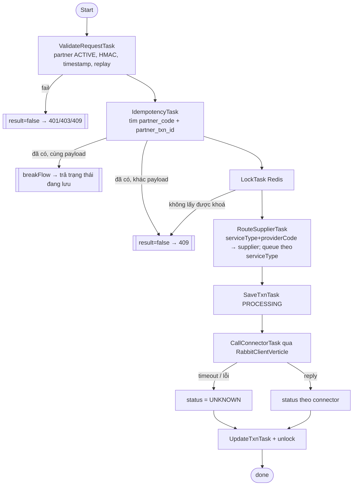
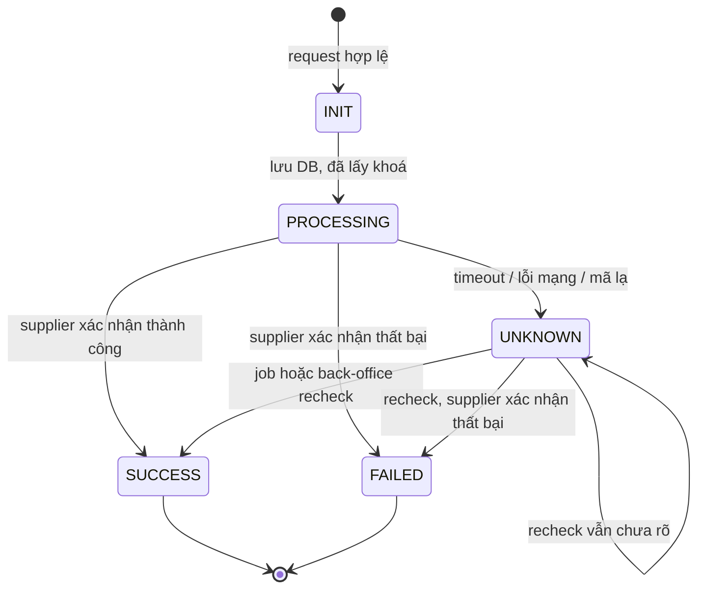

# Payment Hub (Vert.x 5 + RabbitMQ + gRPC) — Design

Ngày: 2026-11-21 · Nguồn: `.claude/vertx-rabbitmq-architecture-prompt.md` + trao đổi brainstorming.

## 1. Mục đích & lý do

Dự án **thử nghiệm / học Vert.x 5** bằng cách tự gõ lại kiến trúc Hub kiểu SPP trên một nghiệp vụ fintech
giả lập: **Payment Hub** cung cấp thanh toán **BILLING** (hoá đơn) và **TOPUP** (nạp tiền) cho nhiều
**partner**, đi qua nhiều **connector (supplier)**. Không kết nối nhà cung cấp thật — mọi supplier là mock.

Người dùng **tự gõ code**; AI đóng vai hướng dẫn theo từng bước (luật làm việc giữ nguyên như prompt gốc:
mỗi lượt 1 bước, giải thích → sơ đồ → code tối thiểu + `// TODO(bạn gõ)` → điểm kiểm tra → câu hỏi tự kiểm).

## 2. Mục tiêu / Không làm / Thất bại dù chạy được

**Mục tiêu**
- Hiểu & dựng được: Launcher + `verticle.json` + Guice; `AppData` + Task/Workflow callback; Route → EventBus →
  WorkflowVerticle; RabbitMQ RPC (Direct Reply-to + cache correlationId); connector theo supplier.
- Nhiều partner (mỗi partner khoá HMAC riêng, idempotency theo partner).
- Connector tách theo **loại dịch vụ**: 1 module + 1 service cho TOPUP (`connector-topup`), 1 cho BILLING
  (`connector-billing`); thêm supplier mới không sửa lõi Hub.
- Hai cửa vào Hub dùng chung Workflow: **REST cho partner**, **gRPC cho back-office**.
- Quản lý trạng thái tiền đúng: SUCCESS / FAILED / UNKNOWN, job tra lại UNKNOWN.

**Không làm (non-goals)**
- Module `noti` (notification), reconciliation (đối soát), `ems` (CDC) — làm sau, chỉ chừa chỗ (mục 9).
- Kết nối supplier thật, giao diện web, deploy k8s/production, Spring, ORM, service mesh.
- gRPC giữa Hub ↔ connector (RabbitMQ giữ vai trò đó).
- Đối soát, sổ cái kế toán, ví/số dư partner.

**Anti-goals (coi là hỏng dù chạy được)**
- Timeout / lỗi mạng / mã lạ bị đánh dấu FAILED (phải là UNKNOWN).
- Chặn event loop (sleep, JDBC/HTTP đồng bộ, `.join()`).
- Route/gRPC handler chứa nghiệp vụ.
- AI viết hộ cả dự án; abstraction "để dành sau".
- Log in nguyên object có dữ liệu khách hoặc secret.

## 3. Ràng buộc kỹ thuật

- **Monorepo, Maven multi-module lồng thư mục**: `pom.xml` gốc (`packaging=pom`) liệt kê mọi module. Chỉ `platform/` là pom trung gian có module con (thư viện dùng chung). `payment-hub/` là **1 module = 1 service**. `connector/` chỉ là thư mục gom, không có pom: bên trong `connector-topup/`, `connector-billing/` là **2 service độc lập**. `supplier-simulator/` là module riêng ở gốc (đóng vai nhà cung cấp ngoài, không thuộc Hub). Sau này thêm `ems/`, `noti/` ngang hàng. Repo `ascend` chưa có code → khởi tạo Maven từ đầu.
- **Java 25**: Maven không tự tải JDK → chạy Maven bằng JDK 25 có sẵn (`25.0.2-tem` qua SDKMAN, file `.sdkmanrc`);
  `maven.compiler.release=25`; `maven-enforcer-plugin` chặn build nếu JDK < 25.
- Thư viện chỉ gồm: Vert.x 5.2.3 (core, web, web-client, rabbitmq-client, pg-client, redis-client,
  grpc-server), Guice, Jackson, Lombok **≥ 1.18.40** (bắt buộc cho JDK 25),
  Caffeine (cache correlationId), protobuf (`protobuf-maven-plugin` + `vertx-grpc-protoc-plugin2`),
  JUnit 5 + vertx-junit5. Bỏ: zipkin, opentracing, json-schema, grpc-client (khỏi hub — chỉ dùng trong test nếu cần).
- Hạ tầng local: `docker-compose.yml` gồm Postgres, RabbitMQ (management 15672), Redis — có healthcheck.
- Config theo profile `app-<profile>.json` trên classpath; secret qua biến môi trường.
- Log / message lỗi trong code: tiếng Anh. Giải thích: tiếng Việt.

## 4. Các hướng đã cân nhắc

**Cấu trúc connector**
- **A. Mỗi supplier 1 module + 1 service riêng** — chọn ở buổi trước, rồi người dùng đổi sang A' khi đặt tên.
- **A'. Mỗi loại dịch vụ 1 connector service** (`connector-topup`, `connector-billing`) — ✅ người dùng chọn
  (2026-11-21). Hiện mỗi loại chỉ có 1 supplier (TOPUP → SUP_A, BILLING → SUP_B) nên vẫn tắt/bật từng connector
  độc lập và thấy từng consumer trên RabbitMQ UI. Code riêng của supplier (`SupAApiClient`, `SupACodeMapper`…) nằm
  trong connector của loại dịch vụ đó. Đổi lại: khi có supplier thứ 2 cùng loại thì phải chọn giữa nhét chung
  connector (chung số phận khi chết) hoặc tách module mới — quyết định lúc đó, không làm sẵn.
- Ghép cả hai (`connector-topup-sup-a`) — rõ nghĩa và mở rộng được nhưng tên dài. Không chọn.
- B. Một `connector-mock` chứa nhiều supplier qua config — nhanh đổi kịch bản lỗi nhưng chung số phận khi chết. Không chọn.

**Vai trò gRPC**
- **1. gRPC là cửa vào nội bộ cho back-office gọi Hub; RabbitMQ giữ nguyên Hub ↔ connector** — ✅ chọn.
  Giữ lõi prompt nguyên vẹn, thêm bài học "đổi cửa vào, không đổi lõi".
- 2. gRPC song song/thay RabbitMQ cho Hub ↔ connector — để so sánh giao thức, phức tạp hơn nhiều. Không chọn.

**Build tool**
- Gradle Kotlin DSL — chọn ở buổi trước (tự tải JDK 25, ít dòng hơn).
- **Maven multi-module** — ✅ người dùng đổi sang (2026-11-21). Khớp prompt gốc / dự án SPP, pom quen thuộc. Đổi lại:
  XML dài hơn, không tự tải JDK (dùng JDK 25 của SDKMAN + enforcer), không phân biệt `api`/`implementation`.

**Một repo hay nhiều repo**
- **Monorepo `ascend`, mỗi service 1 module Maven, chạy / đóng gói độc lập (fat jar)** — ✅ người dùng chọn. `platform` thay đổi
  liên tục khi học → sửa 1 chỗ, build lại cả cụm thấy lỗi ngay; hợp đồng RabbitMQ (`ConnectorRequest`/`ConnectorReply`,
  tên queue) đổi cả 2 phía trong 1 commit; 1 `docker-compose.yml` chạy cả hệ thống. Giá phải trả: dễ import tắt giữa
  service → chặn bằng quy tắc phụ thuộc (mục 9).
- Nhiều repo (`platform` publish thành thư viện có version) — hợp khi nhiều team sở hữu từng service / release riêng.
  Chưa có lý do đó với dự án học 1 người. Không chọn.

## 5. Kiến trúc

Trong Hub: `Route | GrpcService → (EventBus) → WorkflowVerticle → Workflow → Task… → (EventBus) → RabbitClientVerticle → RabbitMQ`.

**Sequence — partner topup đi hết luồng**



**Sequence — back-office gọi qua gRPC**



**Activity — TopupWorkflow (Task tuần tự, dừng khi result=false hoặc breakFlow)**



### 5.1 Module

| Module | Nội dung |
|---|---|
| `platform-core` | `AppData`, `AppDataCodec`, `Task`, `Workflow`, `WorkflowVerticle` base, `MainVerticle` (đọc `verticle.json`, deploy tuần tự, fail fast), `ConfigLoader` (profile + env), Guice module gốc |
| `platform-messaging` | `AbstractRabbitClient` (publish + Direct Reply-to + Caffeine cache), `AbstractRabbitServer` (consume, bỏ redelivered, reply theo `replyTo` + `correlationId`, graceful shutdown, switch INQUIRY/CONFIRM/CHECK_STATUS), `ConnectorMessage` (envelope JSON) |
| `payment-hub` | REST routes, gRPC `BackOfficeService`, các WorkflowVerticle + Task, `RabbitClientVerticle`, DAO Postgres, Redis lock, job tra lại UNKNOWN, file `.proto` |
| `connector/connector-topup` | Connector **TOPUP**, hiện gọi Supplier A. Queue `payment.topup` |
| `connector/connector-billing` | Connector **BILLING**, hiện gọi Supplier B. Queue `payment.billing` |
| `supplier-simulator` | HTTP server giả lập API nhà cung cấp; hành vi điều khiển được (độ trễ, mã trả về, đổi kết quả check-status) để thử timeout/UNKNOWN |

Mỗi service đóng gói thành fat jar và chạy độc lập (`java -jar payment-hub/target/payment-hub.jar`, …), có `verticle.json` + `app-local.json` riêng.

### 5.2 Lệnh nghiệp vụ (type)

- `INQUIRY` — tra hoá đơn (chỉ BILLING): trả số tiền, tên KH (đã che).
- `CONFIRM` — thực hiện thanh toán hoá đơn / nạp tiền.
- `CHECK_STATUS` — tra trạng thái giao dịch ở supplier (dùng bởi API partner, job và back-office).

### 5.3 API cho partner (REST)

Header bắt buộc: `X-Partner-Code`, `X-Request-Id`, `X-Timestamp`, `X-Signature` (HMAC-SHA256 trên
`requestId|timestamp|body`).

| Method & path | Lệnh |
|---|---|
| `POST /v1/billing/inquiry` | INQUIRY |
| `POST /v1/billing/pay` | CONFIRM (BILLING) |
| `POST /v1/topup` | CONFIRM (TOPUP) |
| `GET /v1/transactions/{partnerTxnId}` | đọc trạng thái đang lưu (không gọi supplier) |

Body chỉ chứa ô theo spec (vd topup: `partnerTxnId`, `providerCode`, `phone`, `amount`).
JSON hỏng → 400 ngay. Response chung: `{ requestId, status, errorCode, errorDesc, data }`.

### 5.4 API back-office (gRPC)

`service BackOfficeService`:
- `GetTransaction(partnerCode, partnerTxnId)`
- `ListTransactions(status, limit)` — chủ yếu để xem UNKNOWN
- `RecheckTransaction(partnerCode, partnerTxnId)` — chạy cùng workflow CHECK_STATUS như job
- `SetPartnerStatus(partnerCode, ACTIVE|SUSPENDED)`

gRPC handler giống Route: chỉ map request → `XxxContext` → `eventBus.request(...)` → map ra response.
Xác thực back-office: token tĩnh trong metadata `authorization`, giá trị lấy từ env `BACKOFFICE_TOKEN`.

### 5.5 Định tuyến tới supplier

Hub chọn supplier theo `(serviceType, providerCode)` từ bảng cấu hình trong `app-<profile>.json`
(vd `TOPUP/VIETTEL → SUP_A`, `BILLING/EVN → SUP_B`); không có dòng → `UNSUPPORTED_PROVIDER`. `supplierCode` được lưu vào
giao dịch và gửi trong message để connector biết gọi supplier nào.

**Queue = `payment.<service>`**, `<service>` viết thường: `payment.topup` (connector-topup đọc), `payment.billing`
(connector-billing đọc). Người dùng chọn (2026-11-21): queue chỉ phân biệt theo loại dịch vụ, **không** có queue riêng
cho từng partner (không cần cách ly / xem hàng chờ theo partner). `partnerCode` đi trong header message
(`x-partner-code`, cùng `x-request-id`) để log ở connector vẫn biết request của partner nào.
Thuật ngữ: **partner** = bên gọi vào Hub; **connector / supplier** = bên Hub gọi ra.
Thêm supplier mới cùng loại = thêm code supplier vào connector đó + dòng cấu hình, không sửa Task và không đổi queue.
Log tên queue mỗi lần publish.

### 5.6 Trạng thái giao dịch & tiền



- Chỉ FAILED khi supplier **xác nhận** thất bại. Timeout, lỗi mạng, mã lạ → UNKNOWN.
- Mỗi connector có bảng ánh xạ mã supplier → SUCCESS/FAILED/UNKNOWN; mã không có trong bảng → UNKNOWN.
- Idempotency theo `(partner_code, partner_txn_id)`: trùng + cùng payload (so hash) → trả trạng thái đang lưu,
  không gọi connector; trùng + khác payload → 409.
- Khoá Redis `lock:txn:<partner>:<txnId>` khi xử lý để 2 request đồng thời không cùng gọi supplier.
- Chống replay: `X-Request-Id` lưu Redis TTL (vd 10 phút) theo partner; dùng lại → 409; `X-Timestamp` lệch > 5 phút → 401.

### 5.7 Dữ liệu (Postgres, SQL tay)

- `partner(partner_code PK, name, status, created_at)` — secret HMAC **không** lưu DB; lấy env `PARTNER_SECRET_<CODE>`.
- `payment_txn(id PK, partner_code, partner_txn_id, service_type, provider_code, supplier_code, amount,
  customer_ref, payload_hash, status, supplier_txn_id, error_code, error_desc, created_at, updated_at,
  UNIQUE(partner_code, partner_txn_id))`.
- Migration: file SQL đặt trong `payment-hub/src/main/resources/db/` chạy qua `docker-entrypoint-initdb.d`
  (không dùng Flyway để giữ ít thư viện).

### 5.8 Timeout xếp tầng (giá trị local, chỉnh trong config)

connector → supplier **10s** < Task chờ RabbitClient (cache TTL) **12s** < Route/gRPC chờ WorkflowVerticle **15s**.

### 5.9 Log & trace

Log JSON có `requestId`, `partnerCode`, `supplierCode`; `requestId` đi trong header RabbitMQ để nối log Hub ↔ connector.
Che SĐT / mã KH (giữ 3 số cuối). Bắt context lúc nhận message, gắn lại khi reply. OpenTelemetry: ngoài phạm vi
(chỉ ghi chú bài học), vì đã bỏ thư viện tracing.

## 6. Thứ tự bước (dạy theo bước, người dùng tự gõ)

| Bước | Nội dung | Điểm kiểm tra |
|---|---|---|
| 0 | Khởi tạo Maven multi-module từ đầu + Java 25 + docker-compose | `mvn -q verify` xanh; `docker compose ps` 3 container healthy |
| 1 | Launcher + MainVerticle + `verticle.json` + config profile + Guice | log `deploy HelloVerticle success`; `isDeploy=false` không deploy; 1 verticle hỏng → app dừng |
| 2 | AppData + Codec + Task + Workflow | unit test: A ok, B fail → C không chạy; test breakFlow; test quên `done` → timeout |
| 3 | REST route `/v1/topup` + WorkflowVerticle + workflow giả | curl → 200 đúng body; JSON hỏng → 400 |
| 4 | `platform-messaging` + RabbitClientVerticle (hub) + `connector-topup` (trả dữ liệu cứng) | curl xuyên Hub→SUP_A→Hub; UI 15672 queue có 1 consumer; tắt connector → hết giờ đúng hạn, không treo; bật lại chạy tiếp |
| 5 | `supplier-simulator` + WebClient trong connector + bảng ánh xạ mã + `connector-billing` (BILLING) + bảng định tuyến | simulator chậm hơn timeout → UNKNOWN (không FAILED); billing inquiry/pay đi đúng queue `payment.billing` |
| 6 | Postgres DAO + lưu giao dịch + idempotency + khoá Redis | gửi lại cùng `partnerTxnId` → không gọi connector; khác payload → 409 |
| 7 | Task xác thực đầu workflow: partner tồn tại/ACTIVE, HMAC, timestamp, chống replay | sai chữ ký → 401; requestId dùng lại → 409; partner SUSPENDED → 403 |
| 8 | Job `setPeriodic` tra lại UNKNOWN + log JSON có requestId + graceful shutdown connector | đơn UNKNOWN tự chuyển SUCCESS khi simulator đổi kết quả |
| 9 | gRPC `BackOfficeService` (proto, codegen, server, token) dùng chung workflow | `grpcurl` GetTransaction/ListTransactions trả đúng; RecheckTransaction đổi trạng thái; thiếu token → UNAUTHENTICATED |

Trước bước 0: tóm tắt kiến trúc 10 dòng + 1 sơ đồ Mermaid sequenceDiagram luồng topup đi hết để người dùng xác nhận.

## 7. Quyết định do AI tự chọn (người dùng có thể sửa)

- 2 supplier mẫu: SUP_A (TOPUP), SUP_B (BILLING); thêm `supplier-simulator` làm "nhà cung cấp" giả.
- Header REST và công thức HMAC như 5.3.
- Bảng định tuyến nằm trong config, không trong DB.
- Secret partner qua env `PARTNER_SECRET_<CODE>`; token back-office qua env `BACKOFFICE_TOKEN`.
- Timeout 10s/12s/15s cho local.
- Migration bằng SQL init của Docker, không Flyway.
- gRPC làm sau cùng (bước 9) vì cần DAO và workflow CHECK_STATUS đã có.
- Tên dự án: **ascend** (groupId `dev.gawio`, artifactId = tên module); package giữ namespace tổ chức `dev.gawio`: dùng chung `dev.gawio.platform.*`, payment hub `dev.gawio.payhub.*`, connector `dev.gawio.connector.*`.

## 8. Để người xây dựng tự quyết

Tên class cụ thể ngoài các khối đã nêu, cấu trúc package con, port (gợi ý: hub REST 8080, gRPC 9090,
simulator 8090), số instance trong `verticle.json`, chi tiết format log JSON, dữ liệu seed partner mẫu.

## 9. Bố cục repo & module tương lai

```
ascend/                             (pom.xml gốc, monorepo)
├── pom.xml, .sdkmanrc
├── docker-compose.yml              (hạ tầng chung)
├── platform/                       (pom.xml trung gian — chỉ platform có module con)
│   ├── platform-core               dev.gawio.platform.core
│   └── platform-messaging          dev.gawio.platform.messaging
├── payment-hub/                    1 service: dev.gawio.payhub.hub
├── connector/                      (thư mục gom, không có pom)
│   ├── connector-topup             dev.gawio.connector.topup
│   └── connector-billing           dev.gawio.connector.billing
├── supplier-simulator/             mock nhà cung cấp: dev.gawio.simulator
└── (sau này) ems/, noti/, reconciliation/
```

Quy tắc phụ thuộc: `platform/*` không phụ thuộc module nào khác; `payment-hub/*`, `connector/*` (và sau này `ems`, `noti`) chỉ phụ thuộc `platform`, **không phụ thuộc lẫn nhau** — hub và connector nói chuyện qua RabbitMQ, hợp đồng message nằm trong `platform-messaging`.

Module tương lai (ngoài phạm vi plan này) và điều payment-hub chừa sẵn cho chúng:
- **EMS (CDC)**: đọc thay đổi bảng `payment_txn` qua logical replication → Postgres chạy `wal_level=logical`; bảng có khoá chính, `updated_at`, không xoá cứng.
- **Notification**: sẽ nhận sự kiện đổi trạng thái giao dịch (nhiều khả năng qua luồng CDC); payment-hub không tự gửi thông báo.
- **Reconciliation (đối soát)**: so `payment_txn` (`supplier_txn_id`, `amount`, `status`, `updated_at`) với file/API supplier; payment-hub chỉ cần lưu đủ các cột đó.

