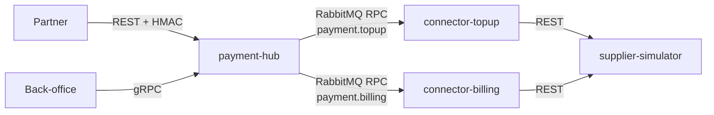

# ascend

Monorepo học **Vert.x 5 + RabbitMQ RPC** theo kiến trúc Hub: dựng một **Payment Hub** giả lập (TOPUP và BILLING)
cho nhiều partner, gọi ra các connector qua RabbitMQ. Không kết nối nhà cung cấp thật — mọi supplier là mock.

> Trạng thái: đang ở bước thiết kế, chưa có code. Các lệnh bên dưới là cách chạy dự kiến sau khi xong từng task.

## Thuật ngữ

- **partner** — bên gọi vào Hub (REST, ký HMAC).
- **connector / supplier** — bên Hub gọi ra (qua RabbitMQ; connector gọi REST tới supplier).
- **back-office** — công cụ nội bộ gọi Hub qua gRPC.

## Kiến trúc



Trong hub: Route / gRPC → EventBus → WorkflowVerticle → Workflow → Task… → RabbitClientVerticle → RabbitMQ.

Queue theo loại dịch vụ: `payment.<service>`

| Queue | Connector đọc | Supplier hiện tại |
|---|---|---|
| `payment.topup` | `connector-topup` | SUP_A |
| `payment.billing` | `connector-billing` | SUP_B |

Message mang header `x-request-id`, `x-partner-code` để nối log Hub ↔ connector. Reply dùng Direct Reply-to
(`amq.rabbitmq.reply-to`) + `correlationId`.

Trạng thái giao dịch: `SUCCESS` / `FAILED` / `UNKNOWN`. Chỉ `FAILED` khi supplier xác nhận thất bại;
timeout, lỗi mạng, mã lạ → `UNKNOWN`, có job tra lại.

## Cấu trúc

```
ascend/
├── platform/                  thư viện dùng chung (module con)
│   ├── platform-core          AppData, Task/Workflow, MainVerticle (verticle.json), config, Guice
│   └── platform-messaging     RabbitMQ RPC base (client/server), hợp đồng message, tên queue
├── payment-hub/               service: REST cho partner, gRPC back-office, workflow, Postgres, Redis
├── connector/                 thư mục gom 2 service độc lập
│   ├── connector-topup        service: TOPUP → SUP_A
│   └── connector-billing      service: BILLING → SUP_B
├── supplier-simulator/        service mock: giả lập supplier (điều khiển độ trễ / mã trả về)
└── (sau này) ems/, noti/
```

Quy tắc phụ thuộc: `platform` không phụ thuộc module nào khác; `payment-hub` và `connector` chỉ dùng `platform`,
không dùng lẫn nhau.

## Công nghệ

Java 25, Maven multi-module, Vert.x 5, Guice, Jackson, Lombok, Caffeine, Protobuf + vertx-grpc,
Postgres 17, RabbitMQ 4, Redis 7, JUnit 5 + vertx-junit5. Không Spring, không ORM.

## Chạy (dự kiến)

```bash
sdk env                           # dùng JDK 25 theo .sdkmanrc (Maven không tự tải JDK)
cp .env.example .env              # điền DB_PASSWORD, PARTNER_SECRET_<CODE>, BACKOFFICE_TOKEN
docker compose up -d              # Postgres, RabbitMQ (UI http://localhost:15672), Redis

mvn verify                        # build + unit test + fat jar cho từng service
mvn -Pit test                     # test cần hạ tầng (@Tag("it"))

java -jar supplier-simulator/target/supplier-simulator.jar   # :8090
java -jar connector/connector-topup/target/connector-topup.jar
java -jar connector/connector-billing/target/connector-billing.jar
java -jar payment-hub/target/payment-hub.jar                 # REST :8080, gRPC :9090
```

Build / test riêng 1 module (kèm module nó phụ thuộc): `mvn -pl payment-hub -am test`.

Profile config: `APP_PROFILE` (mặc định `local`) → `app-<profile>.json`. Secret chỉ qua biến môi trường.

## Tài liệu

- Thiết kế: `.claude/specs/2026-11-21-payment-hub-design.md`
- Kế hoạch từng bước: `.claude/plans/2026-11-21-payment-hub.md`
